# Graph-RAG & AI Code Review Studio

A production-grade, local-first developer platform combining two advanced LLM applications on a shared foundational runtime:
1. **Intelligent Code Reviewer:** Deterministic AST syntax diagnostics paired with LLM-based root-cause analysis, strict JSON contract enforcement, and multi-tier effort controls.
2. **Graph-RAG Codebase Q&A:** A hybrid retrieval engine combining BM25 keyword search, dense vector embeddings, and an AST-derived typed knowledge graph with automated citation verification and an interactive structure inspector.

---

## Architecture Overview

```mermaid
flowchart TD
    subgraph Shared["Foundational Runtime (common/)"]
        CFG["Config & Env Limits"]
        BACKEND{"Backend Selector"}
        OLLAMA["Ollama (Local)<br/>qwen3:8b + nomic-embed-text"]
        GEMINI["Google Gemini (Cloud)<br/>gemini-3.8-flash"]
        BACKEND -->|Default| OLLAMA
        BACKEND -->|CHATBOT_BACKEND=gemini| GEMINI
    end

    subgraph Project1["Project 1: Code Reviewer (code_review/)"]
        INPUT_CODE["Source Code / File Upload"] --> AST_CHECK["Deterministic AST Check<br/>(ast.parse syntax audit)"]
        AST_CHECK --> EFFORT_PROMPT["Effort-Guided Prompting<br/>(Low / Medium / High)"]
        EFFORT_PROMPT --> LLM_GEN["LLM Review Generation<br/>(Temp 0.1, up to 4096 tokens)"]
        LLM_GEN --> JSON_VAL{"JSON Schema Validation<br/>(jsonschema contract)"}
        JSON_VAL -->|Invalid / Truncated| RETRY["Self-Repair Retry Attempt"]
        RETRY --> JSON_VAL
        JSON_VAL -->|Valid| UI_OUTPUT["Severity Grouping & Fixes<br/>Critical / High / Medium / Low"]
        UI_OUTPUT --> FOLLOWUP["Interactive Follow-up Chat<br/>(Threaded context & streaming)"]
    end

    subgraph Project2["Project 2: Graph-RAG Q&A (repo_qa/)"]
        REPO["Git Repository or Local Folder"] --> INGEST["Ingest & Semantic Chunking<br/>(AST symbols, classes, functions)"]
        INGEST --> KG["Knowledge Graph Builder<br/>(NetworkX MultiDiGraph)"]
        INGEST --> VEC["NumPy Dense Vector Store<br/>(Cosine similarity)"]
        INGEST --> BM25["BM25 Inverted Index<br/>(Exact token matches)"]

        KG --> RESOLVE["Edge Confidence Resolver<br/>Certain / Likely / Guess"]
        
        USER_Q["User Question"] --> REWRITE["Conversational Query Rewriter"]
        REWRITE --> HYBRID["Hybrid Search & RRF Fusion<br/>(Vector + Keyword)"]
        HYBRID --> GRAPH_EXP["Knowledge Graph Expansion<br/>(Breadth-first neighbor traversal)"]
        GRAPH_EXP --> BUDGET["Context Budget Assembly<br/>(Expanded 1.5x on High effort)"]
        
        BUDGET --> ANSWER_LLM["Grounded LLM Generation<br/>(Strict context constraint)"]
        ANSWER_LLM --> CITE_CHECK{"Citation Verifier<br/>(path:line validation)"}
        CITE_CHECK -->|Verified| STREAM_OUT["Streaming Response + Sources"]
        CITE_CHECK -->|Unverified| WARN_OUT["Flag Hallucinated Citations"]
    end
```



---

## Key Features

### 1. Dual-Bot Effort Selector (`Low`, `Medium`, `High`)
Both chatbots support configurable effort levels tailored to task complexity:
- **`Low`:** Fast, concise summaries with minimal token footprint for rapid checks.
- **`Medium`:** Balanced architectural depth with standard targeted fixes and explanations.
- **`High` (Default in Web UI):** Exhaustive root-cause analysis, step-by-step logic tracing, failure edge cases, and complete production-ready code patches. In Project 2, high effort expands retrieval context by **1.5x**, enables deeper graph traversals, and allocates up to **4,096 output tokens**.

### 2. Deterministic Verification & Guardrails
- **Pre-flight Syntax Analysis:** Python code undergoes native AST parsing before reaching the model to immediately catch and pinpoint syntax errors.
- **Strict Output Schema:** Reviews are strictly validated against a JSON schema. If the model produces truncated or malformed JSON, the engine automatically attempts self-repair.
- **Citation Checking:** Answers from the Codebase Q&A bot must cite exact `path:lines`. Every cited reference is checked against the actual retrieved context chunks. Hallucinations or out-of-context citations are visibly flagged.

### 3. Typed AST Knowledge Graph
- **Nodes:** `File`, `Class`, `Function`, `DocSection`, `External`.
- **Directed Edges:** `CONTAINS`, `IMPORTS`, `CALLS`, `USES`, `INHERITS`, `DECORATED_BY`, `DOCUMENTS`.
- **Confidence Tiers:**
  - `certain`: Resolved through direct definitions and imports.
  - `likely`: Inferred through inheritance, re-exports, or star imports.
  - `guess`: Inferred by method name match when receiver type is ambiguous.
- **Interactive Visual Canvas:** An offline physics-based HTML5 canvas embedded in the web app allows panning, zooming, dragging nodes, and hovering for deep symbol inspection.
- **Architecture Hubs & Centrality:** Computes in-degree callers and out-degree dependencies to surface the core architectural hubs of any repository.
- **Dependency Path Finder:** Computes shortest dependency chains between any two functions, classes, or files with direction and confidence tracking.
- **Tabular Inspector:** Filter, search, and inspect all graph nodes, edges, and relationship statistics in tabular format.

### 4. Zero-Dependency Test Suite
- Comprehensive suite of **481+ unit and integration tests** executing in under 20 seconds using in-memory mock clients and temporary test repositories—requiring no GPU, internet connection, or active Ollama daemon.

---

## Quickstart & Setup

### 1. Environment Installation
```bash
# Create and activate virtual environment
python -m venv .venv
source .venv/bin/activate       # Windows: .venv\Scripts\activate

# Install dependencies
pip install -r requirements.txt

# Verify environment and layout integrity
python check_setup.py
python check_layout.py
```

### 2. Local Models (Ollama)
The default configuration runs fully local models on your GPU/CPU via [Ollama](https://ollama.com):
```bash
ollama pull qwen3:8b
ollama pull nomic-embed-text
```

### 3. Launch the Streamlit Web Studio
```bash
streamlit run app.py
```
Open [http://localhost:8501](http://localhost:8501) in your browser. Use the sidebar to toggle between **Project 1: Code reviewer** and **Project 2: Codebase Q&A**.

---

## Detailed Component Architecture

### Project 1: Intelligent Code Reviewer (`code_review/`)

```
code_review/
├── __init__.py      # Package exports (CodeReviewer, Review, Issue, etc.)
├── __main__.py      # CLI entry point supporting --effort, --problem, etc.
├── prompts.py       # Effort-tiered system prompts & JSON contracts
├── reviewer.py      # Core review orchestrator, syntax check, follow-up streaming
├── render.py        # Markdown formatting and download report generator
└── schema.py        # Dataclasses & JSONSchema validation with dynamic text limits
```

- **Execution Flow:**
  1. **Source Parsing:** Accepts raw code (pasted or uploaded across 15+ programming languages).
  2. **Pre-flight AST:** When language is Python, `ast.parse` validates syntax. If broken, the exact line and error details are fed directly into the review context.
  3. **Prompt Construction:** Injects the schema definition, problem description, language, and effort directives into the system prompt.
  4. **Validation & Recovery:** Model response is parsed as JSON and validated against `REVIEW_SCHEMA`. On schema validation failure, `_ask_model` triggers a correction pass.
  5. **Threaded Follow-ups:** Maintains an active conversation thread allowing developers to ask follow-up questions, request alternate implementations, or deep-dive into specific issues.

---

### Project 2: Graph-RAG Codebase Q&A (`repo_qa/`)

```
repo_qa/
├── ingest/          # Repository cloning, classification, AST parsing, chunking
├── graph/           # Typed Knowledge Graph (model, builder, import/call resolution)
├── index/           # BM25 token index, NumPy vector store, hybrid search & RRF
├── rag/             # Graph-aware retrieval, prompts, citation validation, chat
├── eval/            # Evaluation harness, benchmark questions, edge accuracy
└── service.py       # Service layer connecting web interfaces and CLIs
```

#### Ingestion & AST Semantic Chunking (`repo_qa/ingest/`)
- Clones remote GitHub repositories or scans local source folders.
- Classifies files (source, doc, config, test, binary/ignored).
- Extracts AST symbols: functions, methods, classes, docstrings, imports, and decorators.
- Chunks code into logical blocks while injecting semantic context headers (`File: ...`, `Class: ...`, `Function: ...`) to maximize vector embedding search precision.

#### Knowledge Graph Construction (`repo_qa/graph/`)
- Encapsulates code topology inside a `networkx.MultiDiGraph`.
- Resolves relationships with multi-level confidence scoring (`certain`, `likely`, `guess`).
- Implements path scoring where a neighbor's score equals the product of confidence weights along the traversal path:
  $$\text{Score}(path) = \prod_{e \in path} W(\text{confidence}(e))$$
  *(Certain: 1.0, Likely: 0.7, Guess: 0.3)*.

#### Hybrid Retrieval Engine (`repo_qa/index/` & `repo_qa/rag/`)
- **BM25 Search:** Tokenizes queries and source text to capture exact identifiers, function names, and error strings.
- **Dense Vector Search:** Employs cosine similarity over `nomic-embed-text` embeddings to capture conceptual meaning.
- **Reciprocal Rank Fusion (RRF):** Fuses ranking lists without manual score calibration:
  $$RRF(d) = \sum_{m \in \{\text{vector}, \text{bm25}\}} \frac{1}{60 + \text{rank}_m(d)}$$
- **Graph Expansion:** Seed nodes from hybrid search hits are expanded outward by $N$ hops to bring in callers, callees, declarations, and definitions into the context budget.

#### Grounded Answering & Citation Checking (`repo_qa/rag/answer.py`)
- Forces the LLM to answer using **only** the provided retrieved chunks.
- Validates every bracketed citation `[path:start-end]` against retrieved chunks. Unverified citations are flagged in the UI to prevent misinformation.

---

## Command Line Interface (CLI) Reference

### Project 1: Code Review CLI
```bash
# Review a local file with high effort
python -m code_review path/to/script.py --effort high

# Provide an observed problem or error message
python -m code_review app/auth.py --problem "Raises 500 when username is null" --effort high

# Specify language explicitly
python -m code_review snippet.js --language javascript --effort medium
```

### Project 2: Codebase Q&A CLI

#### 1. Ingestion
```bash
# Ingest a remote GitHub repo or local folder and inspect chunks
python -m repo_qa.ingest https://github.com/owner/repo --show-chunks 3 --out data/debug/repo
python -m repo_qa.ingest ./my-local-project --out data/debug/local
```

#### 2. Knowledge Graph Inspection
```bash
# Build knowledge graph for a repository
python -m repo_qa.graph https://github.com/miguelgrinberg/microblog

# Query callers, callees, and imports
python -m repo_qa.graph <repo> --callers verify_password
python -m repo_qa.graph <repo> --callees "app/auth/routes.py::login"
python -m repo_qa.graph <repo> --imports app/auth/routes.py
python -m repo_qa.graph <repo> --min-confidence likely

# Surface key architecture hubs (most connected functions and classes)
python -m repo_qa.graph <repo> --hubs 10

# Trace shortest dependency call chain between two symbols
python -m repo_qa.graph <repo> --path login verify_password
```

#### 3. Indexing & Hybrid Search
```bash
# Build keyword-only index (no local embedding model required)
python -m repo_qa.index build https://github.com/miguelgrinberg/microblog --keyword-only

# Build full hybrid index with embeddings
python -m repo_qa.index build https://github.com/miguelgrinberg/microblog

# Search the index
python -m repo_qa.index search data/index/miguelgrinberg__microblog "where is authentication handled?"
python -m repo_qa.index search data/index/miguelgrinberg__microblog "check_password" --mode keyword --show-text
```

#### 4. Interactive RAG Chat
```bash
# Start interactive repository chat session
python -m repo_qa.rag data/index/miguelgrinberg__microblog --effort high

# Ask a single question directly
python -m repo_qa.rag data/index/miguelgrinberg__microblog --ask "Which endpoints require authentication?" --effort high

# Test without graph expansion for baseline comparison
python -m repo_qa.rag data/index/miguelgrinberg__microblog --no-graph
```
*In-chat commands:* `/effort <low|medium|high>`, `/graph <on|off>`, `/mode <hybrid|vector|keyword>`, `/sources`, `/context`, `/clear`, `/quit`.

---

## Evaluation Framework (`repo_qa/eval/`)

The repository includes a scientific evaluation harness to measure retrieval and answer quality across different configurations:

```bash
# 1. Validate dataset integrity and ground-truth questions
python -m repo_qa.eval validate data/index/miguelgrinberg__microblog

# 2. Benchmark retrieval conditions (keyword, vector, hybrid, hybrid+graph)
python -m repo_qa.eval retrieval data/index/miguelgrinberg__microblog

# 3. Evaluate answer generation accuracy (against 25 benchmark questions)
python -m repo_qa.eval answers data/index/miguelgrinberg__microblog --limit 10

# 4. Generate structured evaluation markdown report
python -m repo_qa.eval report data/index/miguelgrinberg__microblog/eval
```

For detailed benchmark metrics and hand-labeling workflows, see [`docs/EVALUATION.md`](file:///home/saeeb/Devel/college-work/PR/RAG-Prompt-Bot/docs/EVALUATION.md).

---

## Configuration Reference

All settings can be configured via environment variables prefixed with `CHATBOT_`:

| Environment Variable | Default Value | Description |
| :--- | :--- | :--- |
| `CHATBOT_BACKEND` | `ollama` | Active backend: `ollama` (local) or `gemini` (cloud) |
| `CHATBOT_CHAT_MODEL` | `qwen3:8b` | Ollama chat model tag |
| `CHATBOT_EMBED_MODEL` | `nomic-embed-text` | Ollama embedding model tag |
| `CHATBOT_OLLAMA_HOST` | `http://localhost:11434` | Ollama daemon URL |
| `CHATBOT_NUM_CTX` | `8192` | Local LLM context window size |
| `CHATBOT_TEMPERATURE` | `0.1` | Generation temperature |
| `CHATBOT_MAX_OUTPUT_TOKENS` | `1024` | Default local token generation limit |
| `GEMINI_API_KEY` | *(None)* | Google Gemini API key (when using cloud backend) |
| `CHATBOT_GEMINI_MODEL` | `gemini-3.8-flash` | Cloud Gemini model name |
| `CHATBOT_GEMINI_THINKING_LEVEL` | `low` | Gemini thinking level: `low`, `medium`, `high`, `none` |
| `CHATBOT_MAX_REPO_FILES` | `3000` | Safety limit for files per repository |
| `CHATBOT_MAX_REPO_BYTES` | `50000000` | Safety limit for repository size (bytes) |
| `CHATBOT_SEARCH_TOP_K` | `8` | Number of chunks returned from hybrid retrieval |

---

## Repository Layout

```
.
├── .streamlit/             # Streamlit server and theme configuration
├── app.py                  # Web application entry point
├── check_layout.py         # File manifest and repository structure validator
├── check_setup.py          # Environment, model, and dependency diagnostic tool
├── code_review/            # Project 1: Prompt-based code reviewer & debugger
├── common/                 # Shared foundation: config, error types, Ollama/Gemini clients
├── data/                   # Default storage: cloned repos, vector indices, graphs
├── docs/                   # Extended guides (EVALUATION.md, CLOUD_TODO.md)
├── eval/                   # Ground-truth questions & labeled call sample datasets
├── repo_qa/                # Project 2: Graph-RAG codebase Q&A system
│   ├── eval/               # Evaluation harness and metric runners
│   ├── graph/              # Typed Knowledge Graph and AST symbol resolution
│   ├── index/              # BM25 token index, NumPy vector store, hybrid search
│   ├── ingest/             # Cloner, language classification, AST chunker
│   ├── rag/                # Hybrid retrieval, prompt orchestration, citation checking
│   └── service.py          # Unified service layer for Web UI and CLI
├── tests/                  # Complete unit and integration test suite (475+ tests)
└── webapp/                 # Streamlit UI pages, custom CSS theme, sidebar components
```

---

## Running the Test Suite

Run the complete offline test suite (475+ tests) at any time:
```bash
.venv/bin/python -m unittest discover -s tests -t .
```
All tests use mock servers and synthetic in-memory repositories—no network, Ollama, or external credentials required.
